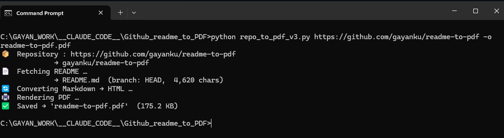

# 📄 GitHub README → PDF Converter
[](https://opensource.org/licenses/MIT)

Convert any GitHub repository's `README.md` into a beautifully rendered PDF — including images, tables, and syntax-highlighted code blocks.

---

## Features

- ✅ Renders **images** (remote, relative, and badge URLs)
- ✅ Renders **tables** (GitHub Flavored Markdown)
- ✅ **Syntax-highlighted** code blocks via Pygments
- ✅ GitHub-style CSS — looks like the real thing
- ✅ Works with **public repos** — no GitHub token required
- ✅ Works with **private repos** via a GitHub personal access token
- ✅ Supports any branch

---

## Requirements

- Python 3.10+
- [Playwright](https://playwright.dev/python/) + Chromium (installed below)

```bash
pip install requests markdown Pygments playwright
playwright install chromium
```

---

## Usage

```bash
# Basic — outputs <repo>_README.pdf in the current directory
python readme_to_pdf.py https://github.com/owner/repo

# Custom output filename
python readme_to_pdf.py https://github.com/owner/repo -o my_output.pdf

# Private repo (or if you hit the GitHub API rate limit)
python readme_to_pdf.py https://github.com/owner/repo --token ghp_xxxx

# Specific branch
python readme_to_pdf.py https://github.com/owner/repo --branch develop
```

### Options

| Flag | Short | Description |
|------|-------|-------------|
| `--output FILE` | `-o` | Output PDF path (default: `<repo>_README.pdf`) |
| `--token TOKEN` | `-t` | GitHub personal access token |
| `--branch BRANCH` | `-b` | Branch to read from (default: repo's default branch) |

You can also supply the token via an environment variable to avoid passing it on the command line:

```bash
export GITHUB_TOKEN=ghp_xxxx
python readme_to_pdf.py https://github.com/owner/repo
```

---

## How It Works

1. **Fetches the README** directly from `raw.githubusercontent.com` — no GitHub API calls, no rate limiting for public repos.
2. **Converts Markdown → HTML** using the `markdown` library with table, fenced code, and syntax-highlighting extensions.
3. **Resolves relative image URLs** to absolute `raw.githubusercontent.com` URLs so all images load correctly.
4. **Renders the HTML → PDF** using a headless Chromium browser via Playwright, which gives pixel-perfect output including images and full CSS support.

---

## Alternative: WeasyPrint

If you prefer not to install Playwright, the script supports [WeasyPrint](https://weasyprint.org/) as a drop-in alternative.

```bash
pip install weasyprint
```

Then replace the `render_pdf` function with the WeasyPrint version:

```python
def render_pdf(html: str, output_path: str) -> None:
    from weasyprint import HTML, CSS
    from weasyprint.text.fonts import FontConfiguration

    font_cfg = FontConfiguration()
    HTML(string=html).write_pdf(
        output_path,
        stylesheets=[CSS(string="@page { size: Letter; margin: 0.75in; }",
                         font_config=font_cfg)],
        font_config=font_cfg,
    )
```

> **Windows users:** WeasyPrint requires the GTK3 runtime libraries which are not bundled with the pip package. If you see an `OSError: cannot load library 'libgobject-2.0-0'` error, install GTK3 from **A SAFE SOURCE**, restart your terminal, and try again. **Playwright has no such requirement** and is the recommended approach on Windows.

---

## Examples

```bash

# This repo's docs
python readme_to_pdf.py https://github.com/gayanku/readme-to-pdf

# FastAPI docs
python readme_to_pdf.py https://github.com/tiangolo/fastapi

# Requests library
python readme_to_pdf.py https://github.com/psf/requests -o requests.pdf

# A private repo using a token
python readme_to_pdf.py https://github.com/myorg/private-repo --token ghp_xxxx
```

  

---

## Troubleshooting

**`OSError: cannot load library 'libgobject-2.0-0'` (Windows)**
You're using WeasyPrint. Switch to Playwright (recommended) or GTK3 from **A SAFE SOURCE**

**`Error: GitHub API rate limit exceeded`**
The unauthenticated GitHub API allows 60 requests/hour. Supply a `--token` to raise this to 5,000/hour. The default raw-URL fetch path avoids the API entirely for public repos.

**`Error: repository 'owner/repo' not found`**
Double-check the URL. For private repos, make sure you pass a valid `--token` with `repo` read scope.

**Images are missing from the PDF**
Ensure you have an internet connection — Playwright fetches images at render time. SVG badges from shields.io and similar services are supported.

---

## License

[](https://opensource.org/licenses/MIT)
